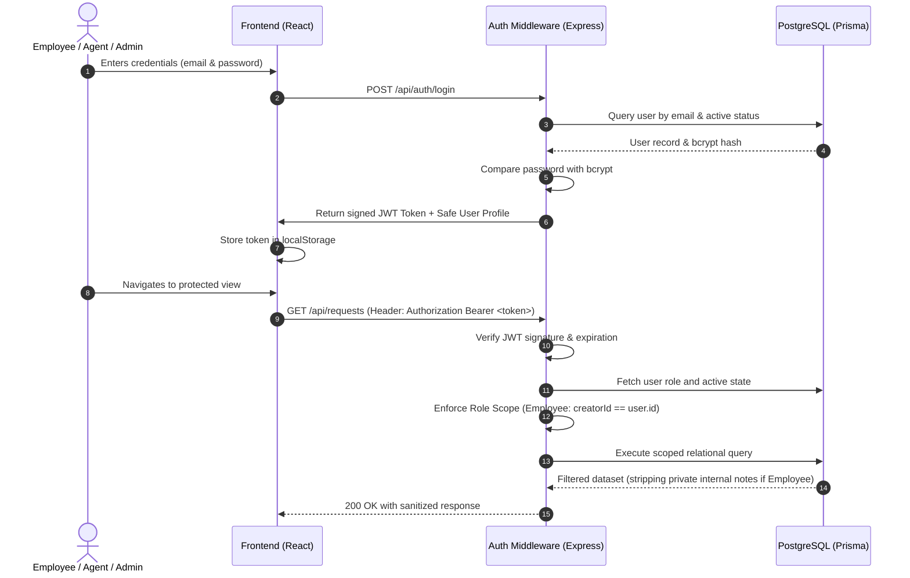
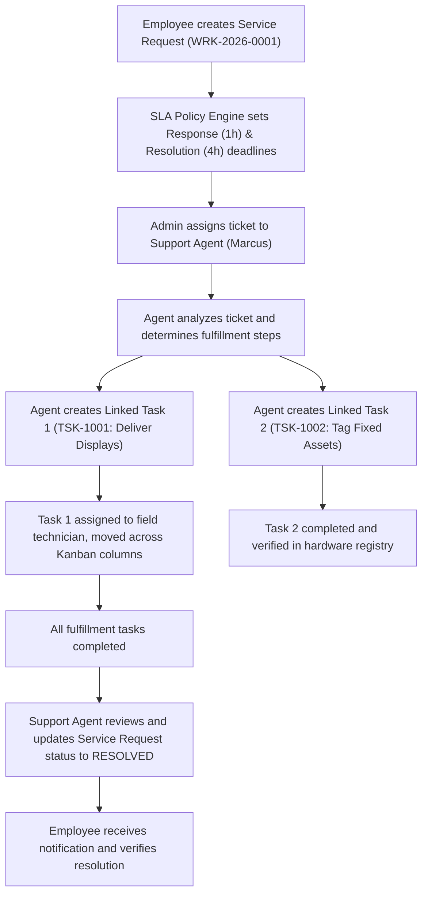

# Architecture & System Design: WorkSphere

## 1. High-Level Architectural Diagram

```
+-----------------------------------------------------------------------------------+
|                                 CLIENT LAYER                                      |
|                                                                                   |
|   React 18 + Vite + TypeScript + Tailwind CSS + Lucide React + Framer Motion      |
|   - Employee Desk            - Agent Queue             - Admin Center             |
|   - Service Request Detail   - Kanban Task Board       - SLA Policy Editor        |
|   - Notification Popover     - Global Search Dialog    - Analytics (Recharts)     |
+-----------------------------------------+-----------------------------------------+
                                          |
                                          | JSON over HTTPS (REST API)
                                          | Bearer JWT Authorization
                                          v
+-----------------------------------------------------------------------------------+
|                                 BACKEND LAYER                                     |
|                                                                                   |
|   Node.js + Express.js + TypeScript                                               |
|   +---------------------+  +----------------------+  +-------------------------+  |
|   |   Auth & RBAC       |  |   Service Desk Core  |  |   Task Management Core  |  |
|   |   Middleware        |  |   (Module A)         |  |   (Module B)            |  |
|   +---------------------+  +----------------------+  +-------------------------+  |
|   | SLA Calculator      |  | ID Generator         |  | Notifications & Audit   |  |
|   | Engine              |  | (WRK / TSK)          |  | Middleware              |  |
|   +---------------------+  +----------------------+  +-------------------------+  |
|                                         |                                         |
|                                 Prisma ORM Layer                                  |
+-----------------------------------------+-----------------------------------------+
                                          |
                                          | PostgreSQL Connection Pool
                                          v
+-----------------------------------------------------------------------------------+
|                                DATABASE LAYER                                     |
|                                                                                   |
|   PostgreSQL Relational Storage                                                   |
|   - Users, Roles, Depts, Teams         - ServiceRequests, Comments, Assignments   |
|   - Tasks, TaskComments, Activities    - SLAPolicies, AuditLogs, Notifications    |
+-----------------------------------------------------------------------------------+
```

---

## 2. Authentication & Authorization Flow



---

## 3. Module Integration Workflow



---

## 4. Key Architectural Decisions

1. **Strict Backend-Enforced Authorization**:
   - Rather than relying on client-side component hiding, queries in `request.controller.ts` automatically inject `where.creatorId = user.id` when the caller possesses the `EMPLOYEE` role.
   - Internal notes (`isInternal = true`) are stripped at the database query level for non-agent users.

2. **Concurrency-Safe ID Generation**:
   - Ticket numbers (`WRK-2026-0001`) and task identifiers (`TSK-1001`) use transactional sequence lookups with formatted zero-padding to guarantee uniqueness without exposing raw database UUIDs.

3. **Prisma Transactions for Multi-Entity Updates**:
   - Ticket assignments, status transitions, and linked task creations run inside atomic `prisma.$transaction` blocks to ensure activity timelines and audit logs never desynchronize.
