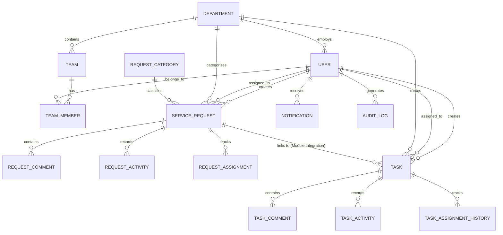

# Database Design & Entity Relationship: WorkSphere

## 1. Relational Entity Overview

WorkSphere is backed by PostgreSQL via Prisma ORM with strict referential constraints, indexing on lookup fields, and relational cascades.

### Shared Entities
1. **`User`**: User accounts with roles (`EMPLOYEE`, `AGENT`, `ADMIN`), department associations, and active status.
2. **`Department`**: Organizational units (IT, HR, Facilities, Finance, Engineering).
3. **`Team` & `TeamMember`**: Functional sub-teams within departments.
4. **`Notification`**: Persistent notification inbox with read tracking.
5. **`AuditLog`**: Immutable activity trail of administrative and security events.

### Service Request Entities (Module A)
6. **`ServiceRequest`**: Core service desk tickets with human-readable `requestId`, priority, status, and SLA deadlines.
7. **`RequestCategory`**: Categories (IT Support, HR, Facilities, Hardware, Access).
8. **`RequestComment`**: Public comments and confidential internal notes (`isInternal: boolean`).
9. **`RequestActivity`**: Audit trail of every status transition and priority change.
10. **`RequestAssignment`**: Assignment and reassignment history.
11. **`SLAPolicy`**: Response and resolution hour thresholds per priority level.
12. **`RequestAttachment`**: File attachments metadata.

### Task Management Entities (Module B)
13. **`Task`**: Operational tasks with sequential `taskNumber`, priority, status, and optional foreign key `serviceRequestId` for module integration.
14. **`TaskComment`**: Task collaboration discussions.
15. **`TaskActivity`**: Task status and assignment audit history.
16. **`TaskAssignmentHistory`**: History of task assignments.
17. **`TaskAttachment`**: File attachments metadata.

---

## 2. Entity Relationship Diagram

---

## 3. Indexing Strategy

To guarantee sub-millisecond query execution across large production datasets, explicit B-tree indexes were created for:
- `ServiceRequest`: `[requestId]`, `[status]`, `[priority]`, `[creatorId]`, `[assignedAgentId]`, `[departmentId]`, `[createdAt]`
- `Task`: `[taskNumber]`, `[status]`, `[priority]`, `[creatorId]`, `[assigneeId]`, `[serviceRequestId]`, `[dueDate]`
- `Notification`: `[userId]`, `[isRead]`, `[createdAt]`
- `AuditLog`: `[actorId]`, `[entityType]`, `[createdAt]`
- `RequestComment`: `[requestId]`, `[isInternal]`
